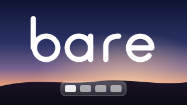
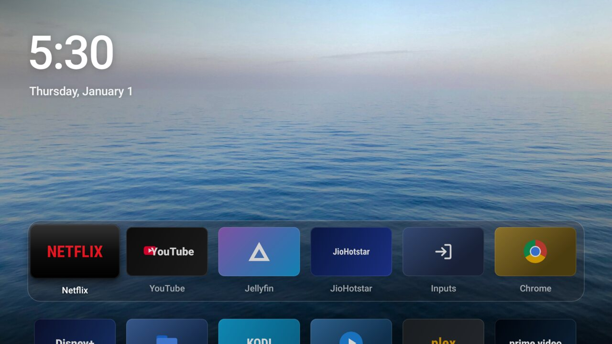
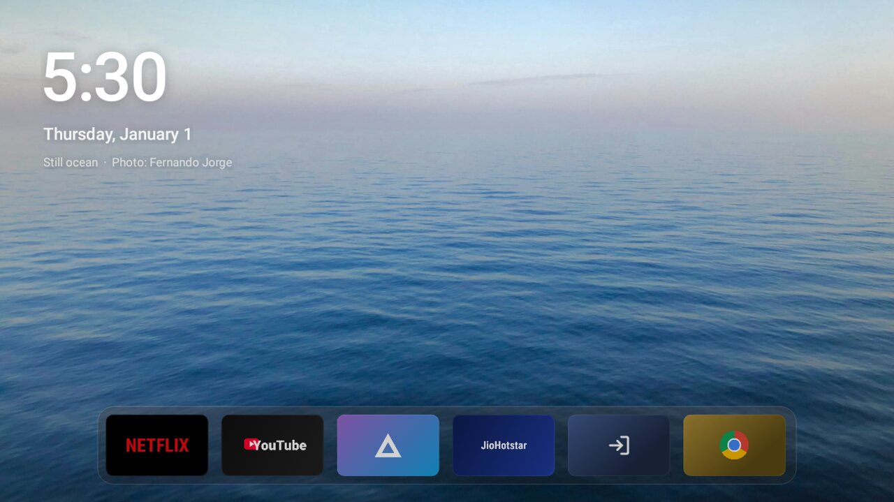
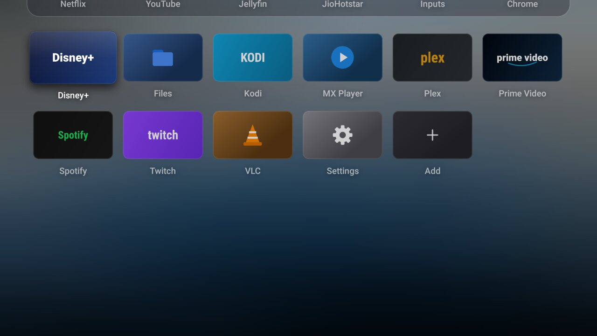
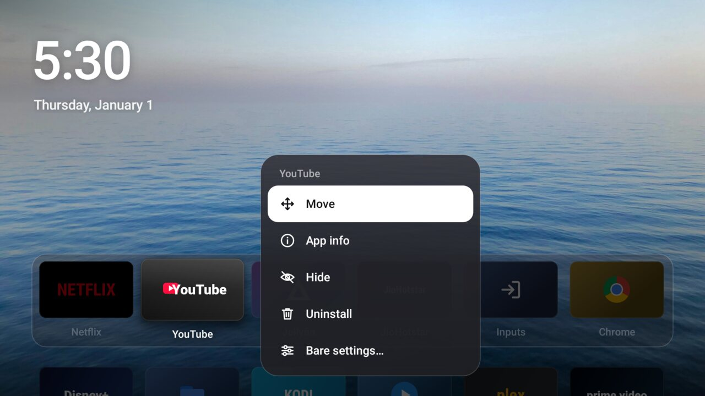
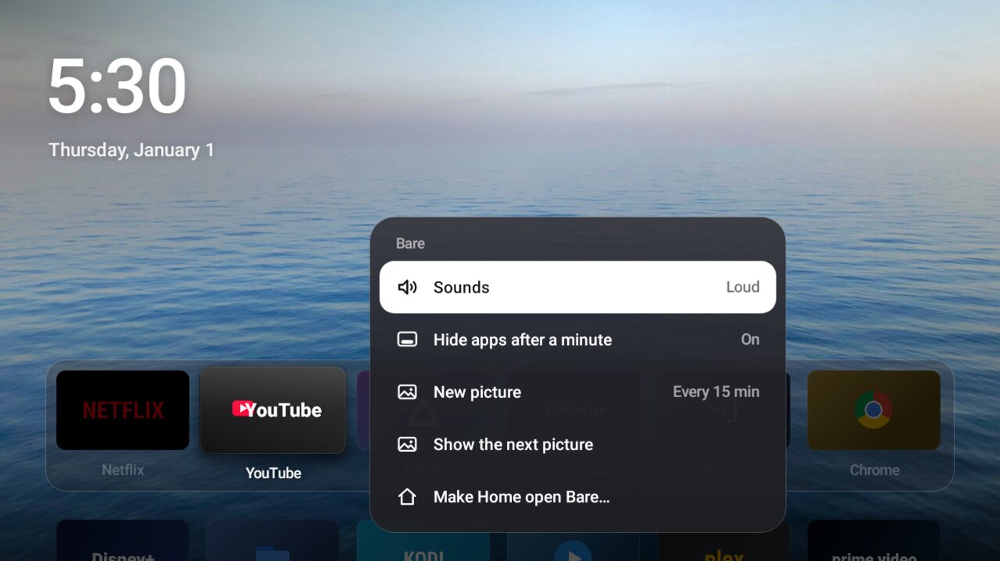

<p align="center">
  
</p>

<h1 align="center">Bare — a calm, Apple TV–style launcher for Android TV</h1>

<p align="center">
  Your apps on a glass dock over a beautiful photo. No ads, no recommendations, no tracking.<br>
  Built for cheap and old Android TVs: one 6 MB APK, no Play Services, runs smoothly on 1 GB of RAM.
</p>

<p align="center">
  
</p>

## Why

Stock Android TV and Google TV home screens are mostly ads: sponsored rows, "recommended for you", apps you never installed. Xiaomi's PatchWall is worse. Bare replaces all of that with the one thing a home screen is for: **your apps, in the order you choose**, over a calm picture, the way tvOS does it.

## Features

- **tvOS-inspired home screen** — a big clock, the date, and your favourite apps in a frosted glass dock with their names.
- **Wallpapers that change on their own** — high-resolution landscape photos (Unsplash), a new one every 15 minutes, hourly or daily.
- **Tuck the apps away** — press Up (or leave the remote for a minute) and the dock slides to the bottom edge so the photo has the screen. Any key brings it back.
- **Every app, one grid** — Down shows the rest of your apps over a frosted copy of the picture.
- **Rearrange, hide, shortcut** — hold OK on any app to move it, hide it, open its info or uninstall it. Add shortcuts to websites or specific activities.
- **Tactile sounds** — soft clicks as focus moves, synthesised on the device (Loud, Soft or Off).
- **HDMI inputs** — one tile lists your TV's inputs.
- **Makes the Home button open Bare** — even on TVs where the firmware launcher can't be replaced (see below).
- **Light and fast** — no Play Services, no network calls, no background work; about 60 fps on a 1 GB Mali-450 TV.
- **Bonus: a reversible debloat script** for Xiaomi Mi TVs, with a dry run and a full rollback ([`debloat/`](debloat/README.md)).

<p align="center">
  
  
  
  
</p>

## Install

You need a computer with [adb](https://developer.android.com/tools/releases/platform-tools) and **Developer options → Network debugging** (or USB debugging) on the TV.

```bash
git clone https://github.com/maharshi878/bare-tv-launcher
cd bare-tv-launcher
wallpapers/fetch.sh            # downloads the 19 photos (5.7 MB) from Unsplash
./build.sh                     # needs the Android SDK command-line tools and a JDK
adb connect <tv-ip>:5555
adb install -r bare.apk
```

Then open **Bare** from your TV's apps row.

### Make the Home button open Bare

Most Android TV firmware gives its own launcher a priority no app can match, so picking Bare as "default home" doesn't stick. Bare instead includes a tiny optional accessibility service that opens Bare when you press Home, and when the stock home screen appears (for example after a reboot). It reads nothing on screen. The stock launcher stays installed and untouched.

- **Most TVs:** in Bare, hold OK on any app → **Bare settings… → Make Home open Bare…**, then turn on **Bare** under Settings → Accessibility.
- **TVs without an Accessibility screen** (Xiaomi Mi TV, some others), from your computer:
  ```bash
  adb shell settings put secure enabled_accessibility_services dev.bare.launcher/.HomeKey
  adb shell settings put secure accessibility_enabled 1
  ```
  To undo: `adb shell settings delete secure enabled_accessibility_services`

## Tested on

| TV | Android | Notes |
|---|---|---|
| Xiaomi Mi TV 4A (MiTV-AXSO0) | 9 (API 28) | 1280×720, 1 GB RAM, Mali-450. Daily driver. |

Bare targets API 21+ and every screen is sized from the display, so 720p, 1080p and 4K TVs should all work. If it runs on yours, please open an issue or PR to add it here.

## Build from source

No Gradle needed for the app: [`build.sh`](build.sh) runs `aapt2 → javac → d8 → zipalign → apksigner` from the Android SDK build tools. [`preview/`](preview/) is a Robolectric harness that renders the real UI to PNGs on your computer (`gradle testDebugUnitTest`), which is how every screenshot here was made. The design notes and requirements live in [`docs/REQUIREMENTS.md`](docs/REQUIREMENTS.md).

**Fonts:** Bare uses the system font. If you have Apple's SF Pro Display installed locally, `build.sh` bundles it into *your own* build (`BARE_FONTS=/path/to/fonts`). It is never committed or distributed, because Apple's licence doesn't allow that.

## FAQ

**Does it show Netflix / YouTube recommendations like Apple TV's Top Shelf?** No. On Android TV that data is readable only by firmware launchers (`ACCESS_ALL_EPG_DATA` is a privileged permission), so Bare shows a photo instead.

**Will it brick my TV?** Bare is an ordinary app: uninstalling it puts everything back. It doesn't disable, remove or root anything. The debloat script only ever *disables* packages, and has a dry run and a rollback.

**Google TV / Chromecast with Google TV / Fire TV?** Should work on Google TV (Android 10+) the same way; untested. Fire TV untested.

## Credits

Wallpapers from [Unsplash](https://unsplash.com/license) by Fernando Jorge, Billy Williams, Kristaps Ungurs, Rohit Dey, Valery Tenevoy, Inggrid Koe, Fabrizio Conti, Ricardo Gomez Angel, Vincent Guth, Darshan Chudasama, Paddma Sambhav, Anuj Bansal, Kiril Dobrev, Jakob Owens, Wes Hicks, Hikarinoshita Hikari, Dulcey Lima, Joel Ambass and Daniel Alexandre Páscoa. The photographer of the photo on screen is shown under the clock when the apps are tucked away.

App names and logos in the screenshots belong to their owners and are drawn as placeholders.

## License

[MIT](LICENSE) © 2026 Maharshi Patel. If Bare made your TV nicer, a ⭐ helps other people find it.
